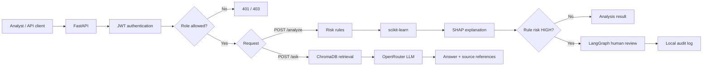
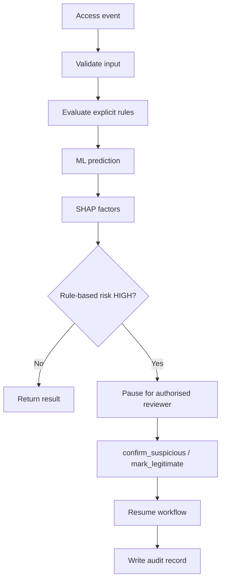
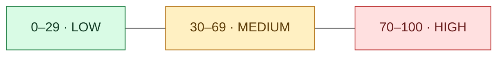
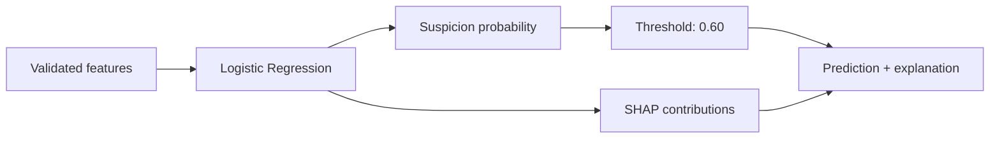
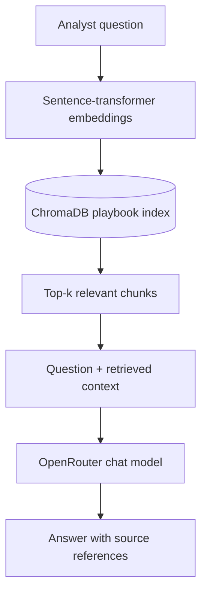
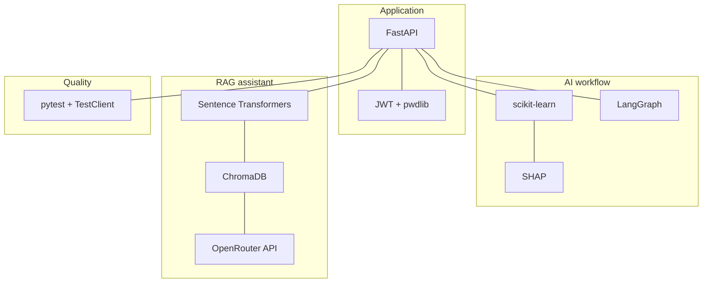
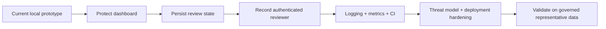

<div align="center">

# 🛡️ IdentityShield AI
### Identity-risk analysis · Explainable ML · RAG · Human review

**A visual-first FDE portfolio project**


[Architecture](#-architecture) · [Workflow](#-access-event-workflow) · [RAG](#-security-assistant-rag) · [API](#-api) · [Run](#-run-locally) · [Limits](#-important-limits)

</div>

> [!WARNING]
> **Prototype only.** Data and profiles are synthetic. No real-world attack validation has been performed. A risk score is a signal for investigation—not proof of compromise. Do not use this project to make real access-blocking decisions.

## 🎯 What it demonstrates

| | Capability | What the analyst gets |
|---|---|---|
| 🧭 | Rule-based risk signals | Score, risk band and reasons |
| 🤖 | Logistic Regression + SHAP | Suspicion probability and feature contributions |
| 🧑‍⚖️ | Human-in-the-loop with LangGraph | Review before a high-risk case is completed |
| 🔐 | JWT + role-based access | Protected analysis and review endpoints |
| 📚 | RAG security assistant | Answers grounded in local playbooks, with source references |
| 🧪 | Automated tests | Regression checks for API, access controls and RAG components |

## 🗺️ Architecture



## 🔄 Access-event workflow



### Rule score at a glance

| Signal | Current contribution |
|---|---:|
| Country differs from user's synthetic home country | +50 |
| Access hour is at least 6 hours from usual hour | +20 |
| Repeated failed attempts | Up to +30 |
| Impossible-travel indicator | +50 |
| New-device indicator | Explanation only; +0 points |



The bands are prototype heuristics, not a calibrated security policy. **Human-review routing uses the rule score, not the ML prediction alone.**

## 🧠 Model & explanation



- **Selected model:** Logistic Regression pipeline.
- **Threshold:** `0.60`, selected using validation data.
- **Alternative:** Random Forest artifact retained for experimentation.
- **Caveat:** metrics on synthetic labels do not prove performance on real attacks.

## 📚 Security assistant (RAG)



**Knowledge base:** local playbooks for impossible travel, repeated failed logins and new-device access.

**Retrieval smoke benchmark:** 3 representative questions; Hit@3 **3/3 (100%)**, MRR@3 **1.000** in the local benchmark. This is a tiny sanity check—not evidence of general RAG quality.

`POST /ask` is restricted to `admin` and `analyst`. Configure `OPENROUTER_API_KEY` locally; never commit it.

## 🔐 Access control

| Role | `GET /profiles` | `POST /analyze` | `POST /review` | `POST /ask` |
|---|---:|---:|---:|---:|
| `admin` | ✅ | ✅ | ✅ | ✅ |
| `analyst` | ✅ | ✅ | ✅ | ✅ |
| `viewer` | ✅ | ⛔ 403 | ⛔ 403 | ⛔ 403 |
| No token | ⛔ 401 | ⛔ 401 | ⛔ 401 | ⛔ 401 |

> **Known security gap:** `GET /dashboard` currently serves the HTML dashboard without authentication. Keep the prototype local until this is addressed.

## 🔌 API

| Method | Route | Purpose | Access |
|---|---|---|---|
| `GET` | `/` | Project metadata | Public |
| `GET` | `/health` | Health response | Public |
| `POST` | `/token` | Issue JWT | Credentials |
| `GET` | `/profiles` | Read synthetic profiles | Authenticated |
| `POST` | `/analyze` | Analyse an access event | `admin`, `analyst` |
| `POST` | `/review` | Submit a pending human-review decision | `admin`, `analyst` |
| `POST` | `/ask` | Ask a playbook-grounded security question | `admin`, `analyst` |
| `GET` | `/dashboard` | HTML dashboard | Currently public ⚠️ |

Interactive API docs: `http://127.0.0.1:8000/docs`

## 🧰 Technology map



## 🚀 Run locally (Windows PowerShell)

```powershell
git clone https://github.com/Mohsen-hub01/identityshield-ai.git
cd identityshield-ai
python -m venv .venv
.\.venv\Scripts\Activate.ps1
python -m pip install --upgrade pip
python -m pip install -r requirements.txt
```

Set local environment variables in the same terminal before starting the API. Use your own values; **never commit secrets**.

```powershell
$env:IDENTITYSHIELD_SECRET_KEY = "<your-random-secret>"
$env:IDENTITYSHIELD_ADMIN_USERNAME = "admin"
$env:IDENTITYSHIELD_ADMIN_PASSWORD = "<local-password>"
$env:IDENTITYSHIELD_ANALYST_USERNAME = "analyst1"
$env:IDENTITYSHIELD_ANALYST_PASSWORD = "<local-password>"
$env:IDENTITYSHIELD_VIEWER_USERNAME = "viewer1"
$env:IDENTITYSHIELD_VIEWER_PASSWORD = "<local-password>"
$env:OPENROUTER_API_KEY = "<your-openrouter-key>"
```

```powershell
python -m uvicorn main:app --reload
```

Open `http://127.0.0.1:8000/docs`, use `POST /token`, then click **Authorize** before calling protected routes.

Run tests:

```powershell
python -m pytest -q
```

Latest recorded full test run: **37 passed, 3 dependency deprecation warnings**.

## ⚠️ Important limits & next steps



- Review state is in memory and may be lost on restart.
- The audit record currently does not reliably identify the authenticated reviewer (`reviewer_identity` may be `null`).
- The dashboard route is not protected.
- Synthetic data cannot validate real-world detection effectiveness.
- Keep the generated ChromaDB store, `.env` files, JWTs, passwords and API keys out of Git.

## 📁 Key project files

```text
main.py                         API, risk analysis, review workflow and /ask endpoint
auth_security.py                JWT and password helpers
users.py                        Environment-configured local accounts
rag/                            RAG configuration, ingestion, retrieval and generation
knowledge/security_playbooks/   Local security playbooks
data/                           Synthetic access events and user profiles
models/                          Saved ML pipelines
tests/                           Automated tests
scripts/evaluation/              Evaluation scripts
```

<div align="center">

**IdentityShield AI** · From identity-risk signals to an integrated, explainable workflow.

</div>
