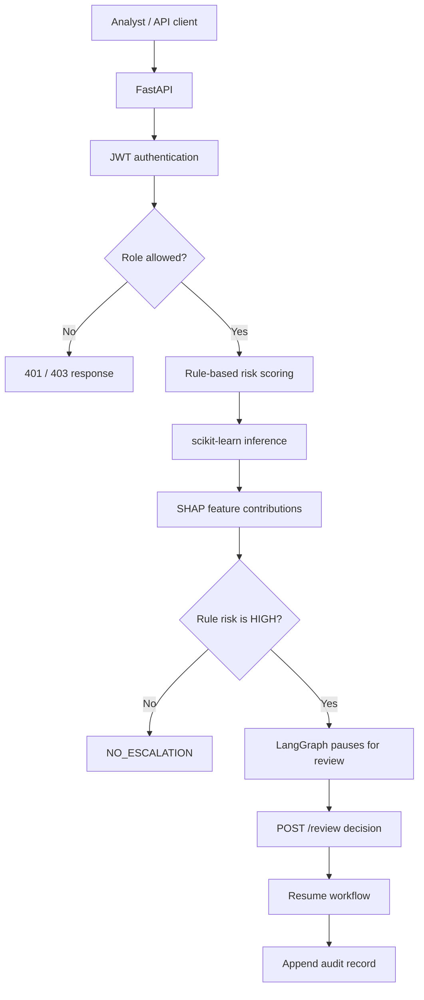

🛡️ IdentityShield AI
From an operational security problem to an integrated AI workflow
An FDE-oriented end-to-end AI engineering portfolio project

A working local prototype combining identity-risk signals, explainable ML, APIs, access controls and human review.

  
  
  
  
  
  
  

Overview · Architecture · Features · Quick start · API · Roadmap

[!IMPORTANT]
Prototype disclaimer: all included datasets and user profiles are synthetic. The system has not been validated against real-world attacks. Predictions are experimental signals—not proof of account compromise—and this project is not production-ready.

🎯 The FDE mission
IdentityShield AI is being built as a Forward Deployed Engineer (FDE) portfolio project. The objective is not merely to train a model or create a notebook. It is to demonstrate the engineering work required to turn an operational problem into a usable, integrated and testable AI-enabled workflow.

The use case is identity and access risk analysis: given a login/access event, help an analyst understand risk signals, inspect a model prediction, and route selected cases to human review.
The FDE approach
<table>
  <tr>
    <td width="25%" valign="top"><h3>🔎 1. Understand</h3>
Frame an operational workflow, identify the signals available, and decide what an analyst needs to see.
</td>
    <td width="25%" valign="top"><h3>🧠 2. Apply AI</h3>
Combine transparent business rules with ML inference and local SHAP explanations.
</td>
    <td width="25%" valign="top"><h3>🔌 3. Integrate</h3>
Expose the workflow through API endpoints, authentication and role-based permissions.
</td>
    <td width="25%" valign="top"><h3>🧪 4. Validate</h3>
Test API behaviour, make limitations explicit, and identify what must change before deployment.
</td>
  </tr>
</table>

Engineering principle: an AI model is only one component. The project explores the path from a problem and data, through inference and user-facing workflow, to controls, tests and operational readiness.
🗺️ Solution architecture

🔄 Event lifecycle
Stage	What happens	Output
1. Input	Client submits an access event	Validated request fields
2. Rule evaluation	Checks country, access hour, failed attempts and impossible-travel signal	Score, risk level and reasons
3. Model inference	Loaded scikit-learn pipeline estimates suspicion probability	Prediction, probability and threshold
4. Explanation	SHAP estimates feature contributions	Ranked explanation factors
5. Routing	High rule-based risk pauses the workflow	Pending review and analysis_id, or no-escalation result
6. Human decision	An authorised user submits an allowed decision	Resumed workflow and recommended action
7. Audit	Completed review is appended to a local JSONL log	Review event record

✅ What is implemented
<table>
  <thead><tr><th>Component</th><th>Current implementation</th><th>Status</th></tr></thead>
  <tbody>
    <tr><td>Risk engine</td><td>Explicit rules over synthetic access-event signals</td><td>✅ Implemented</td></tr>
    <tr><td>ML inference</td><td>Scikit-learn pipeline; selected Logistic Regression configuration</td><td>✅ Implemented</td></tr>
    <tr><td>Explainability</td><td>SHAP contributions returned with the ML result</td><td>✅ Implemented</td></tr>
    <tr><td>Review orchestration</td><td>LangGraph interrupt/resume flow for high rule-based risk</td><td>✅ Implemented</td></tr>
    <tr><td>Authentication</td><td>JWT bearer tokens; 30-minute expiry</td><td>✅ Implemented</td></tr>
    <tr><td>Authorization</td><td>Role dependencies for `admin`, `analyst` and `viewer`</td><td>✅ Implemented for protected API routes</td></tr>
    <tr><td>API / interface</td><td>FastAPI, Swagger UI and HTML dashboard</td><td>✅ Implemented</td></tr>
    <tr><td>Automated tests</td><td>Latest local run: 18 passed, 3 SHAP deprecation warnings</td><td>✅ Baseline suite passes</td></tr>
    <tr><td>Production deployment</td><td>No production deployment or real-world validation claimed</td><td>⏳ Not implemented</td></tr>
  </tbody>
</table>

🧮 Rule-based risk scoring
The current rule engine provides an interpretable baseline. Its scoring logic is intentionally explicit and can be reviewed directly in the code.
Signal	Current scoring behaviour
Country differs from the synthetic user's home country	+50
Access time is at least six hours from the usual hour	+20
At least three failed attempts	Up to +30 based on the attempt count
Impossible-travel indicator is set	+50
New-device indicator	Added as an explanation reason; currently adds no points
Score cap	100 maximum

Risk bands currently used by the code:
  0 ───────────── 29  LOW
 30 ───────────── 69  MEDIUM
 70 ───────────── 100 HIGH
These are prototype heuristics, not a calibrated policy. The HIGH routing decision is based on the rule-based risk level, not solely on the ML prediction.
🤖 Machine learning & explainability
- Selected model: Logistic Regression pipeline.
- Decision threshold: 0.60, from the validation-selected configuration.
- Alternative artifact: Random Forest, retained for experimentation.
- Explanation: SHAP contributions help interpret which input features move the prediction toward or away from the suspicious class.
The model response includes the prediction, suspect probability, decision threshold and ranked explanation factors. Model performance against synthetic labels does not establish production detection performance.
🧑‍⚖️ Human-in-the-loop review
When the rule-based risk level is HIGH, the graph pauses and returns an analysis_id plus review context. The reviewer can submit one of these decisions:
- confirm_suspicious
- mark_legitimate
The workflow then resumes and produces a recommended action. Completed review records are appended to reports/human_review_audit.jsonl at runtime.
Known limitation: the current LangGraph checkpointer is in-memory, so a pending review may be lost after an application restart. The audit record also currently leaves reviewer_identity as null.

🔐 Authentication & role-based access control
The API uses environment-configured accounts, password hashing with pwdlib, and signed JWT bearer tokens. Tokens expire after 30 minutes.
Role	GET /profiles	POST /analyze	POST /review
admin	✅	✅	✅
analyst	✅	✅	✅
viewer	✅	⛔ 403	⛔ 403
Unauthenticated	⛔ 401	⛔ 401	⛔ 401

The table describes the current dependency policy for these endpoints; broader automated tests for the complete permission matrix remain a roadmap item.
Security note: GET /dashboard currently serves the HTML file without an authentication dependency. Protect it before exposing this application beyond trusted local development.

🧰 Technology stack
Technology	Role in the project
🐍 Python	Application and analysis logic
⚡ FastAPI	REST API and OpenAPI/Swagger documentation
📊 scikit-learn + joblib	Model pipeline and saved model artifacts
🔍 SHAP	Prediction explainability
🕸️ LangGraph	Human-review interrupt/resume workflow
🔑 PyJWT	Token signing and validation
🔒 pwdlib	Password hashing and verification
🧱 Pandas + NumPy	Tabular data processing
🧪 pytest + TestClient	Automated API and behaviour tests

📁 Repository map
identityshield-ai/
├── main.py                         # API, rules, ML/SHAP, LangGraph workflow, endpoints
├── auth_security.py                # JWT and password-security helpers
├── users.py                        # Environment-configured development accounts
├── dashboard.html                  # HTML dashboard
├── data/
│   ├── access_events.csv           # Synthetic access events
│   └── user_profiles.csv           # Synthetic user profiles
├── models/
│   ├── logisticregression.joblib
│   └── randomforest.joblib
├── reports/
│   ├── error_analysis/             # Model error-analysis outputs
│   ├── figures/                    # Evaluation figures
│   ├── final_evaluation/
│   └── threshold_selection/        # Validation-based model/threshold selection
├── scripts/
│   ├── data/                       # Generation, validation, exploration
│   ├── evaluation/                 # Evaluation, thresholds and explanations
│   └── training/                   # Model training
├── tests/
│   └── test_main.py
└── .gitignore
🚀 Quick start
The steps below follow the current Windows PowerShell development setup. A pinned requirements.txt or lockfile has not yet been added, so the commands install main dependencies without guaranteeing a fully reproducible environment.
1. Clone the repository
git clone https://github.com/Mohsen-hub01/identityshield-ai.git
cd identityshield-ai
2. Create a virtual environment
python -m venv .venv
.\.venv\Scripts\Activate.ps1
python -m pip install --upgrade pip
3. Install main dependencies
python -m pip install fastapi "uvicorn[standard]" python-multipart PyJWT "pwdlib[argon2]" pandas numpy scikit-learn joblib shap langgraph pytest httpx matplotlib
Dependency pinning and a clean-environment installation check are planned improvements.
4. Configure environment variables
Generate a strong local secret key:
python -c "import secrets; print(secrets.token_urlsafe(48))"
Set the generated value and local test-account credentials in the same PowerShell session before launching Uvicorn. Replace all placeholders locally; never commit the values.
$env:IDENTITYSHIELD_SECRET_KEY = "<your-long-random-secret>"

$env:IDENTITYSHIELD_ADMIN_USERNAME = "admin"
$env:IDENTITYSHIELD_ADMIN_PASSWORD = "<your-local-admin-password>"

$env:IDENTITYSHIELD_ANALYST_USERNAME = "analyst1"
$env:IDENTITYSHIELD_ANALYST_PASSWORD = "<your-local-analyst-password>"

$env:IDENTITYSHIELD_VIEWER_USERNAME = "viewer1"
$env:IDENTITYSHIELD_VIEWER_PASSWORD = "<your-local-viewer-password>"
The example usernames are for local development, not production defaults. Do not expose the secret key, passwords or JWTs in screenshots, issues or logs.
5. Start the API
uvicorn main:app --reload
Local URL	Purpose
http://127.0.0.1:8000/docs	Swagger UI
http://127.0.0.1:8000/	Project metadata
http://127.0.0.1:8000/health	Basic health response

In Swagger, use Authorize to authenticate before calling protected routes. POST /token accepts username and password form fields.
🔌 API at a glance
Method	Route	Access	Purpose
GET	/	Public	Project and model metadata
GET	/health	Public	Basic health response
POST	/token	Public	Validate credentials and issue a JWT
GET	/profiles	Authenticated user	Return synthetic profiles
POST	/analyze	admin, analyst	Analyse an access event
POST	/review	admin, analyst	Submit a decision for a pending review
GET	/dashboard	Currently public	Serve the HTML dashboard

Example: analyse an event
POST /analyze
{
  "user_id": "user_002",
  "country": "France",
  "hour": 10,
  "failed_attempts": 0,
  "new_device": 0,
  "ip_risk_score": 10,
  "impossible_travel": 0
}
A completed analysis returns rule-based risk details, ML output, SHAP explanations, a recommended action and a synthetic-data disclaimer. A high rule-based risk result can instead return status: "awaiting_human_review" with an analysis_id.
Example: submit a review decision
POST /review
{
  "analysis_id": "<analysis_id_returned_by_analyze>",
  "decision": "confirm_suspicious"
}
Use the actual ID from a pending analysis. The other supported decision is mark_legitimate.
🧪 Tests
Run the test suite from the repository root after installing dependencies and configuring a local test secret if needed:
python -m pytest -q
Latest recorded local result: 18 passed, 3 warnings. The warnings were SHAP dependency deprecation notices. Results may vary with installed library versions.
🧭 FDE-oriented roadmap
The next steps focus on closing the gap between a working local prototype and an operationally reliable application.
- [x] Translate the identity-risk use case into an API workflow
- [x] Implement explicit risk rules and ML inference
- [x] Return SHAP explanations with predictions
- [x] Route high rule-based risk to human review
- [x] Add JWT authentication and RBAC dependencies
- [x] Adapt baseline tests to authenticated analysis
- [ ] Add a pinned dependency file and reproducible setup
- [ ] Expand tests for every role and protected endpoint
- [ ] Protect the dashboard route
- [ ] Persist human-review workflow state across restarts
- [ ] Record authenticated reviewer identity in audit entries
- [ ] Add structured logging, request/analysis correlation and operational metrics
- [ ] Add CI for tests and code-quality checks
- [ ] Review the threat model, privacy controls, deployment configuration and secret management
- [ ] Validate the approach on governed, representative data before making real-world performance claims
⚠️ Limitations & responsible use
- Datasets and user profiles are synthetic.
- Metrics against synthetic labels do not establish real-world security effectiveness.
- The prototype is not hardened or validated for production use.
- The dashboard route currently lacks authentication.
- Pending review state is held in memory.
- Reviewer identity is not yet recorded in the audit log.
- Dependencies are not pinned for reproducible deployment.
- The complete role-permission matrix needs automated test coverage.
- Only trusted model artifacts should be loaded, with compatible runtime dependencies.
Do not use this prototype as the sole basis for blocking accounts or making high-impact security decisions.
📄 License
No license file is currently included. Reuse and redistribution permissions have not been explicitly granted.

IdentityShield AI · An FDE-oriented project connecting AI, product workflows, API integration, security controls, testing and human oversight.

