<div align="center">

# 🛡️ IdentityShield AI

### Intelligent Identity-Risk Detection & Investigation Platform

**Explainable Machine Learning · RAG · MCP Agents · Human-in-the-Loop**

A visual-first AI engineering portfolio project.


[Architecture](#-system-architecture) ·
[Detection](#-identity-risk-detection) ·
[ML & SHAP](#-explainable-machine-learning) ·
[RAG](#-security-assistant-rag) ·
[MCP Agent](#-mcp-agent-architecture) ·
[Evaluation](#-evaluation-results) ·
[Installation](#-installation)

</div>

> [!WARNING]
> **Research and portfolio prototype.**
> The project uses synthetic users and access events. It has not been validated against representative real-world attacks. Risk scores are investigation signals, not proof of compromise. Do not use this prototype for real access-blocking decisions.

---

# 🎯 1. Project Overview

IdentityShield AI is an AI-powered identity-risk analysis platform designed to demonstrate how machine learning, explainability, retrieval-augmented generation and agentic workflows can support security investigations.

The platform analyzes access events, identifies suspicious patterns, explains model predictions and provides security analysts with contextual information.

### Main capabilities

| Component | Purpose | Output |
|---|---|---|
| Risk Engine | Evaluate explicit security rules | Risk score and reasons |
| Machine Learning | Estimate suspicious activity | Prediction and probability |
| SHAP | Explain model predictions | Feature contributions |
| LangGraph | Coordinate investigation workflow | Human-review routing |
| RAG | Retrieve security knowledge | Grounded answers and sources |
| MCP Agent | Orchestrate security tools | Investigation report |
| FastAPI | Expose application services | Protected API endpoints |

---

# 🏗️ 2. System Architecture

The platform combines an API layer, a detection engine, an AI investigation workflow and a knowledge assistant.

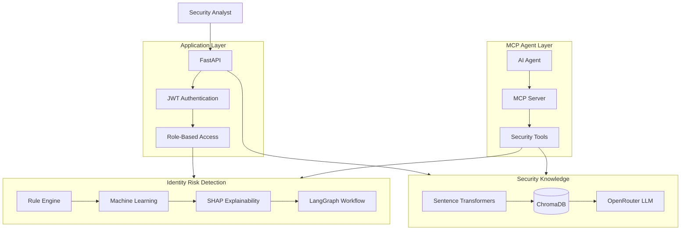

### Main architectural layers

- **Application:** API endpoints, authentication and access control.
- **Detection:** deterministic rules, ML predictions and explanations.
- **Knowledge:** security playbooks and retrieval.
- **Agent:** MCP-based orchestration of available tools.

---

# 🔍 3. Identity Risk Detection

The detection engine evaluates an access event using the user's synthetic profile and security signals.

### Detection workflow

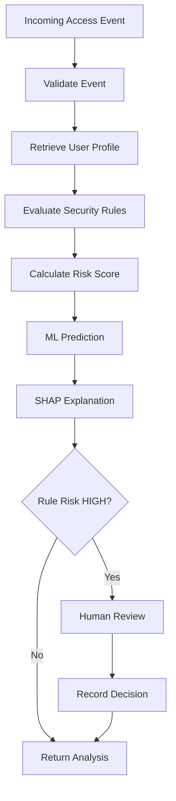

### Rule-based risk signals

| Security signal | Contribution |
|---|---:|
| Country differs from home country | +50 |
| Access hour differs by at least 6 hours from usual hour | +20 |
| Failed attempts | Up to +30 |
| Impossible travel indicator | +50 |
| New device | Explanation only, +0 |

The score is capped at 100.

### Risk classification

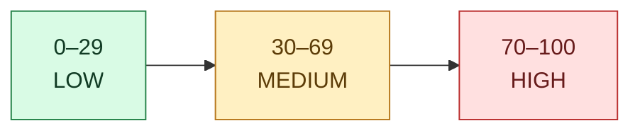

**Important:** These thresholds are prototype heuristics, not a calibrated security policy. Human-review routing is based on the rule-based risk level, not solely on the ML prediction.

---

# 🧠 4. Explainable Machine Learning

The project uses a Logistic Regression pipeline to estimate suspicious access activity.

### ML prediction pipeline

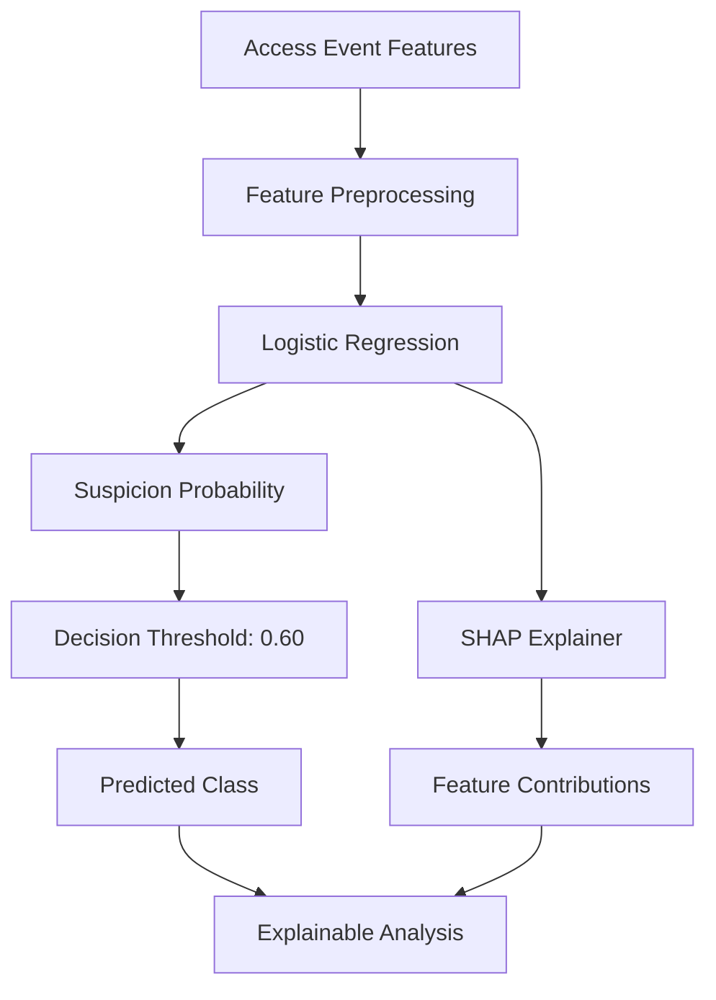

### Model configuration

- **Selected model:** Logistic Regression.
- **Decision threshold:** 0.60.
- **Alternative:** Random Forest artifact retained for experimentation.
- **Explainability:** SHAP feature contributions.

SHAP helps explain which input features influence a model prediction.

The model is experimental: performance on synthetic labels does not establish effectiveness against real attacks.

---

# 📚 5. Security Assistant (RAG)

The RAG component allows analysts to ask questions about security scenarios using locally indexed security playbooks.

### RAG workflow

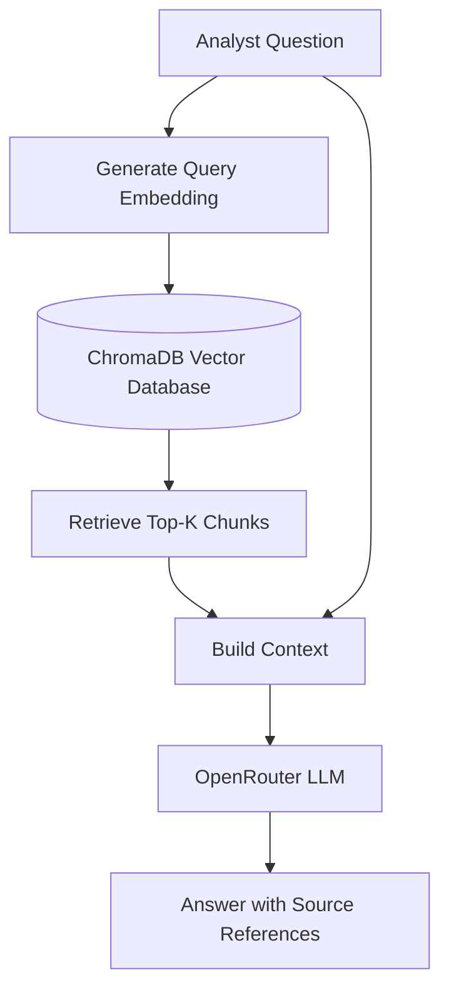

### Knowledge base

Local security playbooks cover:

- Impossible travel.
- Repeated failed logins.
- New-device access.

### Retrieval benchmark

| Metric | Result |
|---|---:|
| Representative questions | 3 |
| Hit@3 | 3/3 (100%) |
| MRR@3 | 1.000 |

This is a small retrieval sanity check, not evidence of general RAG quality.

---

# 🤖 6. MCP Agent Architecture

The MCP Agent provides an agentic interface to the IdentityShield security capabilities.

It uses an LLM to interpret analyst requests, select authorized tools, retrieve their results and generate an investigation report.

### Agent architecture

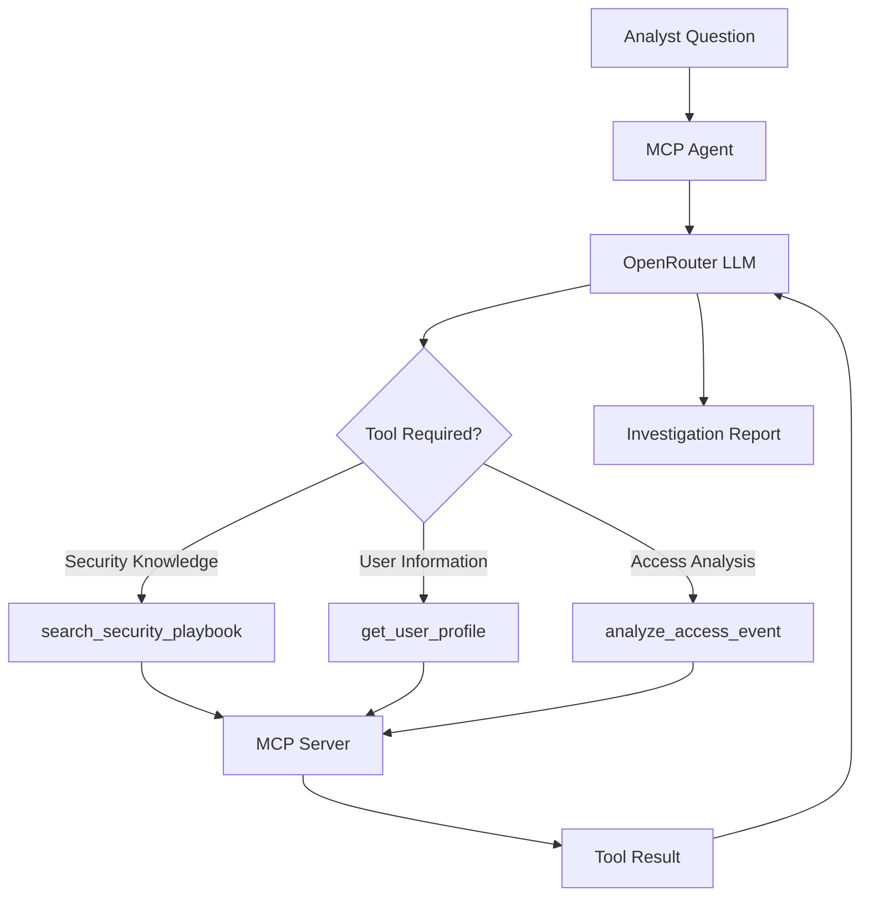

### Available MCP tools

| Tool | Description |
|---|---|
| `search_security_playbook` | Search relevant security documentation |
| `get_user_profile` | Retrieve a synthetic user profile |
| `analyze_access_event` | Execute identity-risk analysis |

The agent uses an explicit allowlist of tools. The human-review decision tool is not exposed to the agent.

### Agent execution sequence

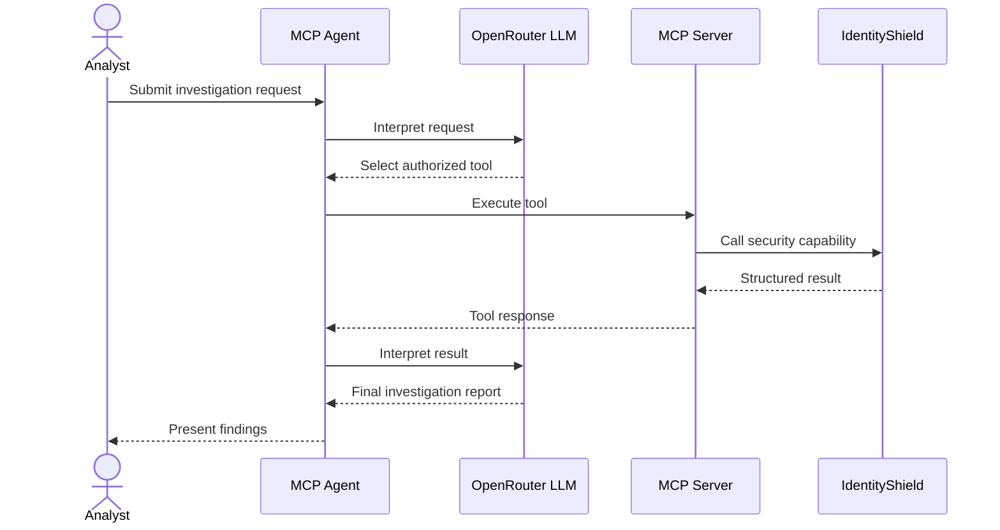

### Missing information handling

The agent performs deterministic validation before executing an access analysis.

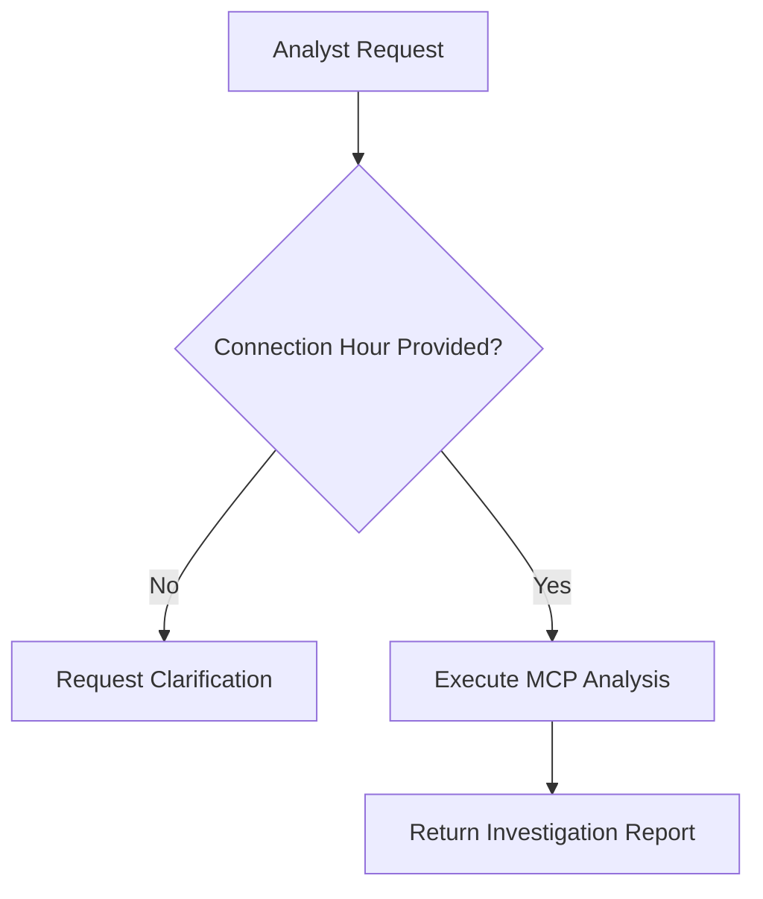

The agent must not infer the actual connection hour from the user's usual-hour profile.

---

# 🧑‍⚖️ 7. Human-in-the-Loop

High-risk cases can pause the LangGraph workflow for an authorized human review.

### Review process

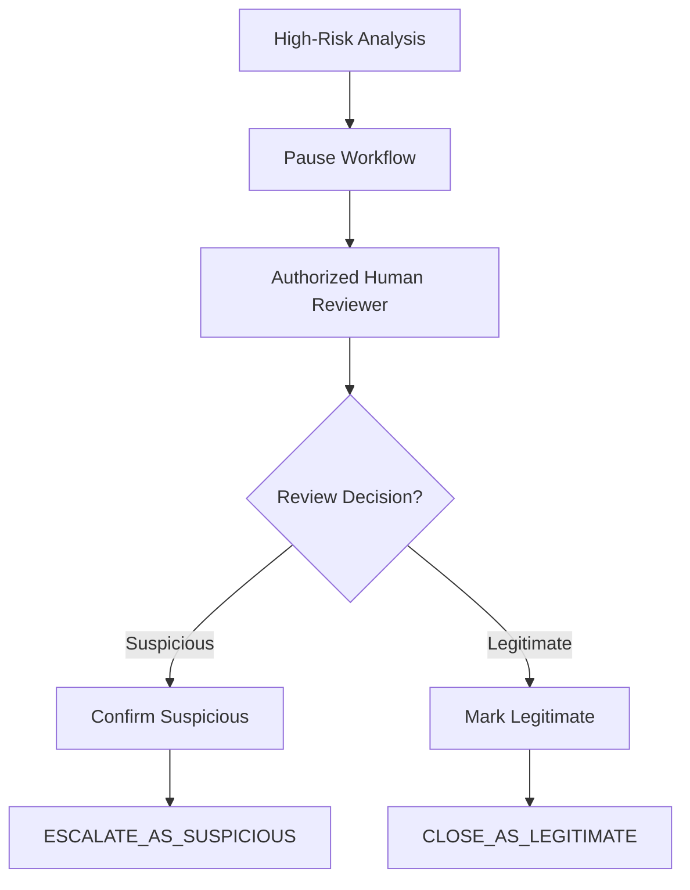

Supported decisions:

- `confirm_suspicious`
- `mark_legitimate`

The MCP Agent cannot directly submit these human-review decisions.

**Implementation limitations:** review state is currently held in memory, and the authenticated reviewer identity is not reliably persisted. The review interface should not be considered production-ready.

---

# 🔐 8. Authentication and Access Control

The API uses JWT authentication and role-based access control.

| Role | Profiles | Analyze | Review | Ask |
|---|---:|---:|---:|---:|
| admin | Yes | Yes | Yes | Yes |
| analyst | Yes | Yes | Yes | Yes |
| viewer | Yes | No | No | No |
| No token | No | No | No | No |

### API endpoints

| Method | Route | Purpose |
|---|---|---|
| GET | `/` | Project metadata |
| GET | `/health` | Health response |
| POST | `/token` | Issue JWT |
| GET | `/profiles` | Read synthetic profiles |
| POST | `/analyze` | Analyze access event |
| POST | `/review` | Submit review decision |
| POST | `/ask` | Ask security assistant |
| GET | `/dashboard` | HTML dashboard |
| GET | `/api/ui/overview` | Dashboard metrics, insights and dataset provenance |
| GET | `/api/ui/identities` and `/api/ui/identities/{user_id}` | Identity directory and detail |
| GET | `/api/ui/events` | Filtered and paginated synthetic access events |
| GET | `/api/ui/threat-graph` | Identity-country relationship graph |
| GET | `/api/ui/analytics` | Risk, activity and model metrics |
| GET | `/api/ui/playbooks` | Local playbook documents |
| POST | `/api/ui/playbooks/search` | Semantic search with local keyword fallback |
| GET | `/api/ui/review-audit` | Review history for admin and analyst roles |

> [!WARNING]
> The dashboard route is currently public. Keep the prototype local until this security gap is addressed.

Interactive API documentation: `http://127.0.0.1:8000/docs`

### Copilot frontend and backend experience

The project includes a React and TypeScript frontend connected to the existing FastAPI backend. The Copilot interface uses the request and response contracts for `/ask`, `/analyze` and playbook search. Shared TypeScript types in `frontend/src/types/api.ts` describe these payloads, and the API client in `frontend/src/services/api/` handles authentication, requests and API errors.

Copilot responses show returned playbook sources, analysis results, model explanations and human-review status. The interface does not claim that a request is streaming or that an MCP tool ran when the browser is using the RAG or analysis endpoints.

The authenticated application also includes the security overview, identity directory, risk analysis, incident review, playbooks, threat intelligence and analytics. Charts and relationship visuals use API responses derived from the synthetic repository data and display provenance notes. The identity-country graph is interactive when WebGL is available and has a non-WebGL fallback.

The browser Copilot currently calls `/ask`, `/analyze` and `/api/ui/playbooks/search`. The MCP agent described above is a separate backend component; it is not exposed as a browser Copilot endpoint.

---

# 📊 9. Evaluation Results

The project includes automated tests and a separate MCP Agent scenario evaluator.

### Pytest results

```text
52 passed
3 warnings
```

### MCP Agent evaluation

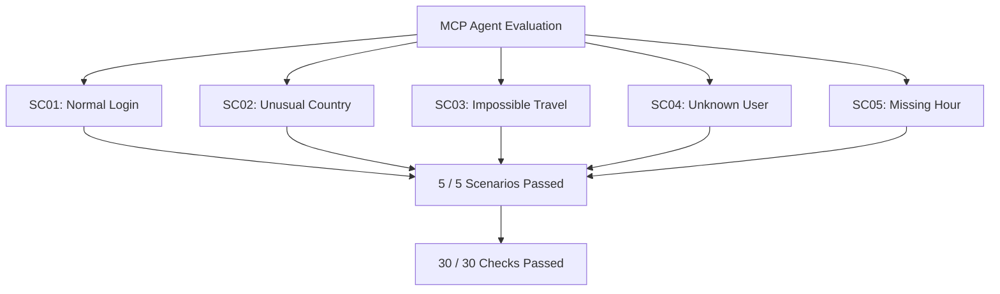

### Final evaluation summary

| Metric | Result |
|---|---:|
| Pytest tests | 52 passed |
| MCP scenarios | 5/5 |
| MCP checks | 30/30 |
| Scenario success rate | 100% |
| Check success rate | 100% |

Evaluation report:

` scripts/evaluation/reports/latest_evaluation.json `

These results validate the implemented test cases only. They do not guarantee complete security or production readiness.

---

# 🛠️ 10. Technology Stack

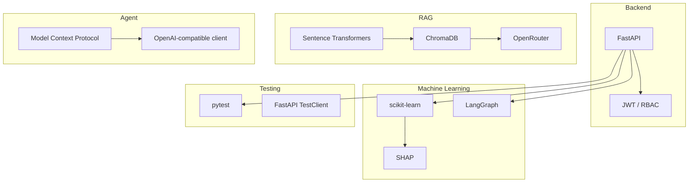

| Category | Technologies |
|---|---|
| Language | Python 3.11 |
| API | FastAPI |
| Authentication | JWT, pwdlib |
| Frontend | React, TypeScript, Vite |
| Frontend data | TanStack Query, typed API contracts |
| Frontend visualization | Recharts, Three.js, React Three Fiber, Drei |
| Machine Learning | scikit-learn |
| Explainability | SHAP |
| Workflow | LangGraph |
| RAG | Sentence Transformers, ChromaDB |
| LLM | OpenRouter |
| Agent communication | Model Context Protocol (MCP) |
| Testing | pytest, FastAPI TestClient |

---

# 🚀 11. Installation

### 1. Clone the repository

```powershell
git clone https://github.com/Mohsen-hub01/identityshield-ai.git
cd identityshield-ai
```

### Run the full application with Docker Compose

Docker Desktop with Docker Compose is the recommended way to start the frontend and API together. Copy the example environment file, then replace the placeholder values with a long random secret and local account passwords. Add an OpenRouter API key if you want generated RAG answers.

```powershell
Copy-Item .env.example .env
```

Start both services from the repository root:

```powershell
docker compose up --build
```

Open the application at `http://localhost:8080`. The API documentation is available at `http://localhost:8080/docs`. Nginx serves the frontend and proxies API requests to FastAPI; the backend container is not directly published to the host.

On first startup, the backend downloads the configured sentence-transformers embedding model and builds the playbook vector index. This requires network access and can take several minutes. The ChromaDB index, model cache and review audit file are stored in Docker volumes and persist across container restarts. To rebuild the index after changing playbooks, run:

```powershell
docker compose exec backend python -m rag.ingest
```

Stop the containers with `Ctrl+C`, or run `docker compose down` in another terminal. Keep `.env` private; it is excluded from the Docker build context and must never be committed.

### Run locally without Docker

### 1. Create the virtual environment

```powershell
python -m venv .venv
.\.venv\Scripts\Activate.ps1
```

### 2. Install dependencies

```powershell
python -m pip install --upgrade pip
python -m pip install -r requirements.txt
```

### 3. Configure environment variables

Create a local `.env` file using the variables required by your configuration.

Example:

```env
IDENTITYSHIELD_SECRET_KEY=your-random-secret
IDENTITYSHIELD_ADMIN_USERNAME=admin
IDENTITYSHIELD_ADMIN_PASSWORD=your-password

IDENTITYSHIELD_ANALYST_USERNAME=analyst1
IDENTITYSHIELD_ANALYST_PASSWORD=your-password

IDENTITYSHIELD_VIEWER_USERNAME=viewer1
IDENTITYSHIELD_VIEWER_PASSWORD=your-password

OPENROUTER_API_KEY=your-openrouter-key
```

Never commit `.env`, API keys, passwords or JWTs.

### 4. Start the API

In one terminal, from the repository root:

```powershell
python -m uvicorn main:app --reload
```

Open:

`http://127.0.0.1:8000/docs`

### 5. Start the frontend

In a second terminal:

```powershell
cd frontend
npm install
npm run dev
```

Open `http://localhost:5173`. The Vite development server proxies API requests to `http://127.0.0.1:8000`. Configure frontend accounts and passwords in the root `.env`; do not use placeholder credentials.

To check a production frontend build:

```powershell
npm run build
```

### 6. Run tests

```powershell
python -m pytest -q
```

### 7. Run the MCP Agent

```powershell
python -m identityshield_mcp.agent
```

---

# 📁 12. Project Structure

```text
identityshield-ai/
│
├── main.py
├── auth_security.py
├── users.py
├── dashboard.html
│
├── app/
├── data/
├── models/
├── rag/
├── knowledge/
├── storage/
│
├── identityshield_mcp/
│   ├── agent.py
│   ├── server.py
│   └── __init__.py
│
├── frontend/
│   ├── src/
│   │   ├── features/
│   │   ├── services/
│   │   └── types/
│   ├── package.json
│   └── vite.config.ts
│
├── scripts/
│   ├── data/
│   ├── training/
│   └── evaluation/
│       ├── agent_scenarios.json
│       ├── evaluate_agent.py
│       └── reports/
│
├── tests/
│   ├── test_main.py
│   ├── test_rag.py
│   └── mcp/
│
├── requirements.txt
└── README.md
```

---

# ⚠️ 13. Limitations and Future Improvements

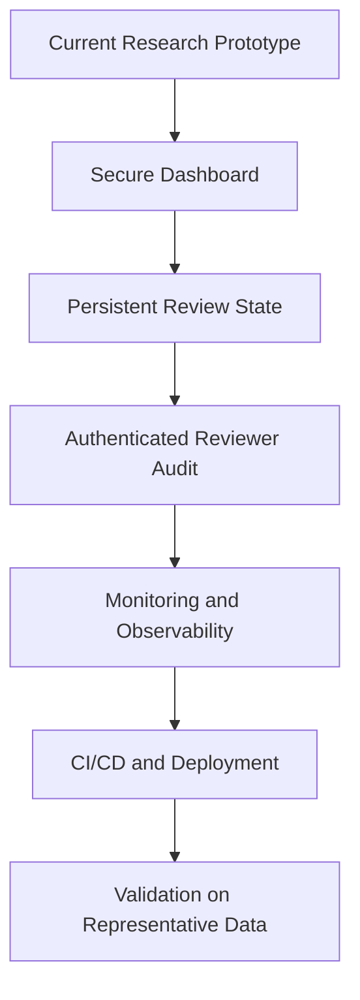

Current limitations:

- Synthetic data and profiles.
- No real-world attack validation.
- In-memory review state.
- Reviewer identity is not reliably persisted.
- Public dashboard endpoint.
- Small RAG retrieval benchmark.
- No production security certification.

Potential future improvements:

- Persistent audit and review storage.
- Dashboard authentication.
- Monitoring and structured logging.
- Expanded security evaluation.
- Representative and governed datasets.
- Automated CI/CD pipeline.
- Deployment hardening.

---

<div align="center">

## IdentityShield AI

**From identity-risk signals to explainable security investigations.**

Built as an AI Engineering and cybersecurity portfolio project.

</div>
